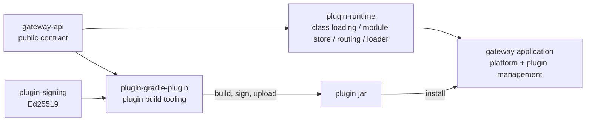
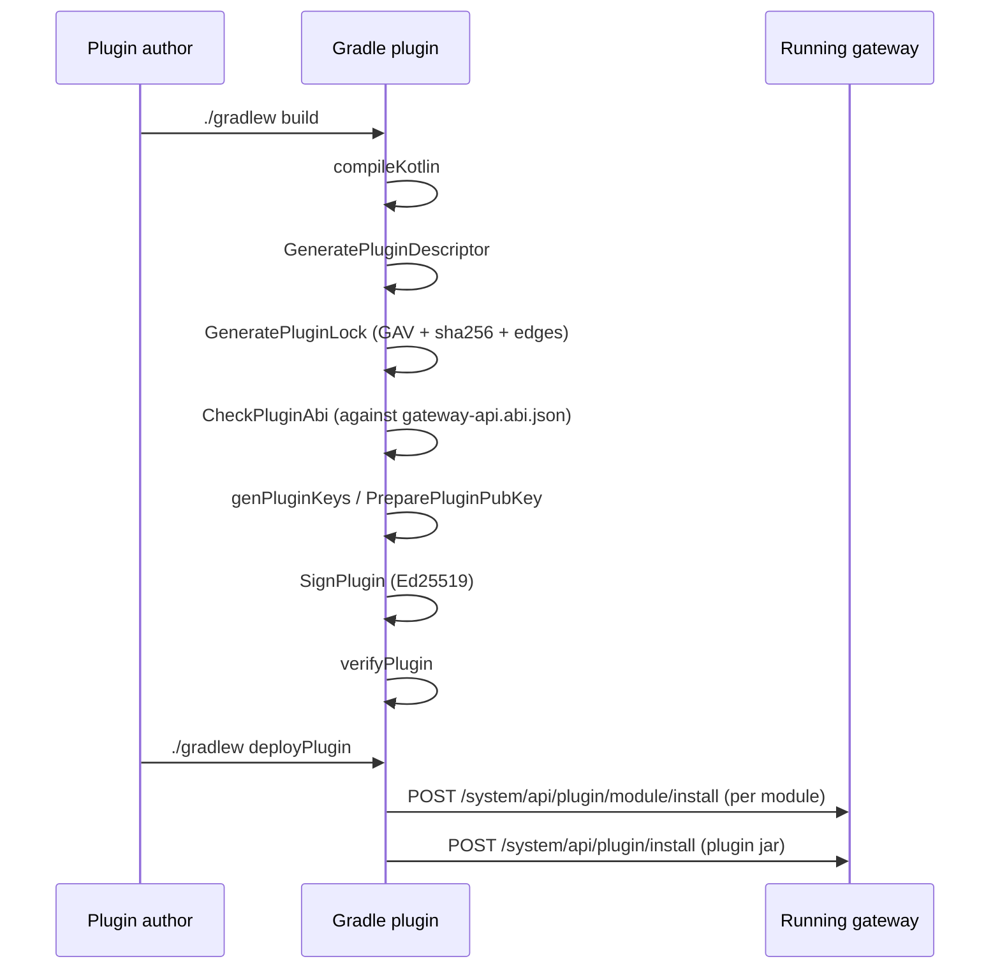
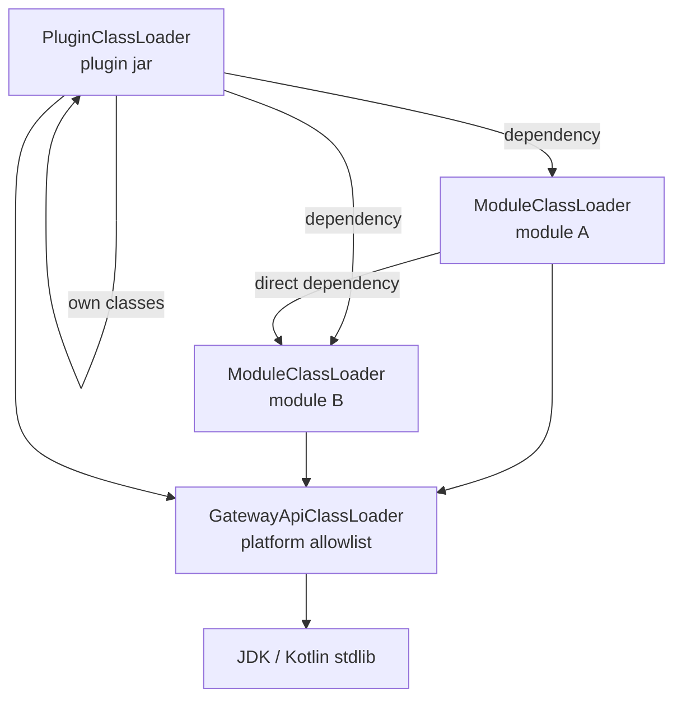
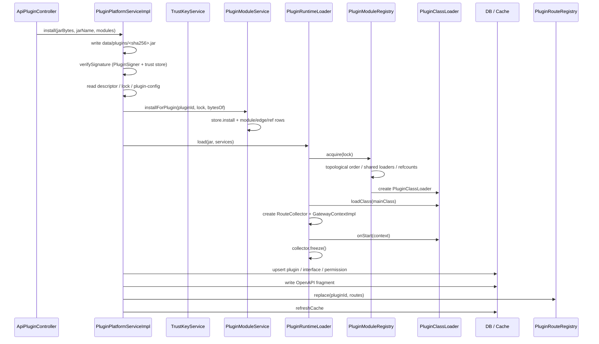
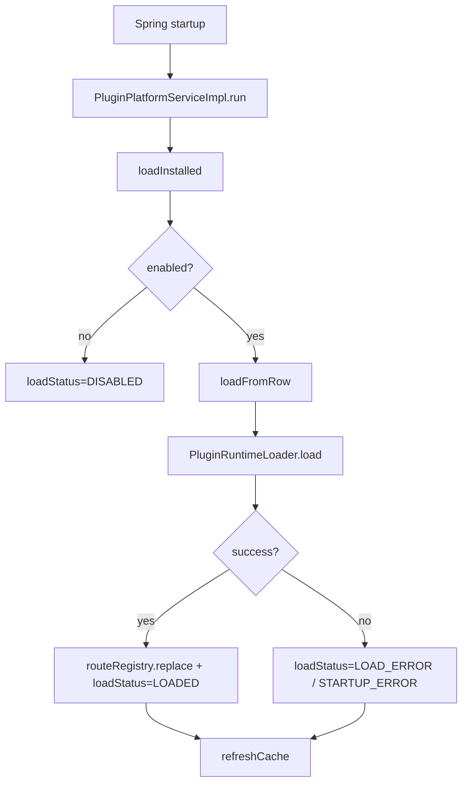
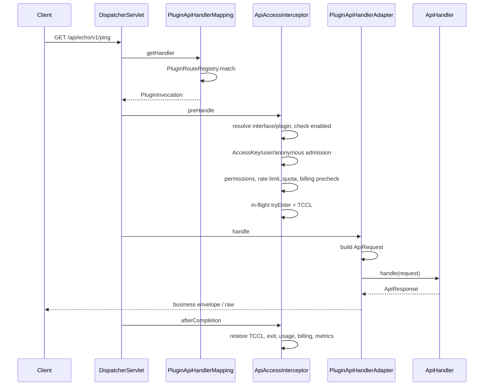
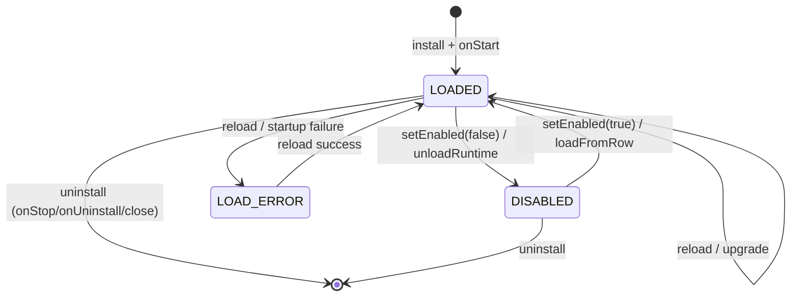
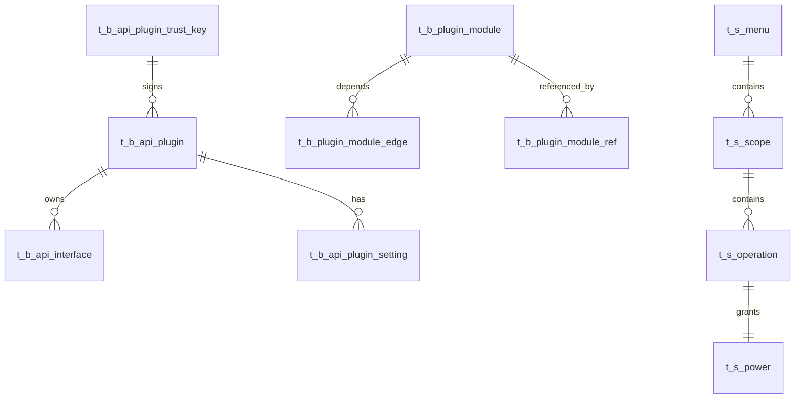

# Plugin Platform Architecture

English | [简体中文](plugin-platform_zh.md)

This document follows the full lifecycle — build → install → start → request → disable/uninstall — and covers modules, key files, component relationships and call chains.

## 1. Design goals

- The gateway core owns platform capabilities: users, RBAC, audit, AccessKey, billing, rate limits, settings and plugin management.
- Every API is contributed by a plugin.
- A plugin can see only **JDK + Kotlin stdlib + `gateway-api`**; Spring, Jackson, MyBatis, Hikari, JDBC drivers and Flyway are the plugin's own modules.
- Plugin dependencies are locked at build time; the runtime consumes the lock without resolving versions.
- Plugins reach the platform only through `GatewayContext`; the Spring container is not exposed.
- A plugin jar is Ed25519-signed, and the signer must be enabled in the trust key table.

## 2. Module map



| Module | Responsibility |
|---|---|
| `gateway-api/` | The only dependency a plugin needs: lifecycle, routes, request/response and capabilities |
| `plugin-runtime/` | Gateway-side runtime: platform loader, module loaders, module store, lock, route table, plugin loader |
| `plugin-signing/` | Ed25519 signing and verification shared by the gateway and Gradle tooling |
| `plugin-gradle-plugin/` | Plugin author tooling: descriptor, lock, ABI check, signing, deploy |
| Gateway application `src/main/kotlin/...` | Platform core, management API, database, auth, billing, audit and plugin install orchestration |

## 3. Contract layer: `gateway-api`

Package: `top.fatweb.apimanagement.api.v1`.

### 3.1 Lifecycle and routing

| File | Content |
|---|---|
| `ApiPlugin.kt` | `onStart(GatewayContext)`, `onStop()`, `onUninstall()`, `onPurge()` |
| `GatewayContext.kt` | The plugin's only entry point, aggregating all capabilities |
| `ApiRoutes.kt` | `register(RouteDefinition, ApiHandler)`, valid during `onStart` only |
| `ApiHandler.kt` | Single-request SAM interface |
| `RouteDefinition.kt` | HTTP method, plugin-relative path, route API version, `OperationMetadata` |
| `OperationMetadata.kt` | `operationId`, summary, description, parameters, request body schema, responses, tags |
| `ParameterSpec.kt` / `ParameterLocation.kt` | Parameter name, location (path/query/header/cookie), type, format, enum, required flag, description, example |
| `ResponseSpec.kt` | Response description, response body schema, example |
| `SchemaSpec.kt` | Recursive JSON Schema node for request and response bodies: type, format, properties, required, items, enum, example, nullable |

Routes are exposed as:

```
/api/{pluginId}/v{route.apiVersion}{route.path}
```

A request may use a higher version than the route declares. When multiple declared versions match the same path, the highest declared version not above the requested version wins.

### 3.2 Request and response

| File | Content |
|---|---|
| `ApiRequest.kt` | method, path, requested API version, path/query/header, principal, traceId, interfaceInfo, raw body |
| `ApiResponse.kt` | Business envelope `{code, success, msg, data}`; `raw()` bypasses it for bytes/text |
| `ApiException.kt` | Plugin business exception, converted to the unified error response |
| `ApiPrincipal.kt` / `PrincipalType.kt` | Caller identity: anonymous, logged-in user, AccessKey |
| `InterfaceInfo.kt` | Runtime governance snapshot of the matched interface: code, price, billing mode, rate limit, access mode |
| `Balance.kt`, `UserInfo.kt`, `PluginMetadata.kt` | Read-only platform data and runtime metadata |

### 3.3 Capabilities

| File | Capability |
|---|---|
| `Settings.kt` | Read plugin settings, read secrets, write plugin-owned keys |
| `DataSources.kt` | Plugin-private datasources as `javax.sql.DataSource` |
| `Storage.kt` | Content-addressed (SHA-256) storage, location-addressed files, login-free external links |
| `Users.kt` | Read-only user information and balance |
| `AuditSink.kt` / `AuditEvent.kt` | Write platform audit events |
| `EventBus.kt` / `Subscription.kt` | In-process event bus, subscriptions cancelled on unload |
| `HttpCapability.kt` | Outbound HTTP |
| `Scheduler.kt` | Fixed-delay and cron scheduling, cancelled on unload |
| `JsonCodec.kt` | Gateway JSON codec, keeping Jackson types out of the plugin boundary |
| `PluginLogger.kt` | Logger carrying pluginId and traceId |

### 3.4 ABI manifest

The `GenerateGatewayApiAbi` task in `gateway-api/build.gradle.kts` scans compiled classes and writes:

```
META-INF/gateway-api.abi.json
```

It contains JVM descriptors for public/protected classes, constructors, methods and fields. Plugin builds compare plugin bytecode against it.

### 3.5 Java plugin authors

- Callback interfaces are SAMs: `ApiHandler`, `EventBus.EventSubscriber`, `Subscription`.
- Factory methods use `@JvmStatic`; constructors with defaults use `@JvmOverloads`.
- `GatewayContext` exposes accessors such as `ctx.api()` and `ctx.settings()` rather than Kotlin properties.

## 4. Build time: `plugin-gradle-plugin`



| File | Responsibility |
|---|---|
| `ApiPluginExtension.kt` | `apiPlugin { }` DSL: pluginId, versionCode, mainClass, requiresGateway, requiresGatewayApi, deploy settings |
| `ApiPlugin.kt` | Applies the plugin, adds `compileOnly gateway-api`, registers tasks, puts generated files into the jar |
| `ApiPluginTasks.kt` | `GeneratePluginDescriptor`, `GenPluginKeys`, `PreparePluginPubKey`, `SignPlugin`, `VerifyPlugin`, `DeployPlugin` |
| `GeneratePluginLock.kt` | Builds `META-INF/api-plugin-deps.json` from `runtimeClasspath`, copies module jars into `build/generated/api-plugin-modules/` |
| `CheckPluginAbi.kt` | Parses plugin class constant pools and checks class/method/field/constructor references to `top.fatweb.apimanagement.api.*` |
| `plugin-signing/PluginSigner.kt` | Builds the jar manifest, signs, verifies, computes SPKI fingerprints |

### Plugin jar entries

```
META-INF/api-plugin.json        descriptor format 1
META-INF/api-plugin-deps.json   dependency lock
META-INF/plugin.pub.pem         signer public key
META-INF/plugin.sig             Ed25519 signature
```

`GeneratePluginLock` excludes:

- `top.fatweb:api-management-gateway-api` (platform)
- `org.jetbrains.kotlin:kotlin-stdlib*` (platform)
- `org.jetbrains:annotations`

All other runtime dependencies enter the lock and are uploaded as independent modules.

## 5. Runtime: class loading and module store

### 5.1 Three class loader layers



| File | Responsibility |
|---|---|
| `classloader/GatewayApiClassLoader.kt` | Allows only `java.`, `javax.`, `jdk.`, `sun.`, `kotlin.`, `top.fatweb.apimanagement.api.`; everything else throws `ClassNotFoundException` |
| `classloader/ModuleClassLoader.kt` | Child-first: own jar → direct dependency module loaders → platform |
| `classloader/PluginClassLoader.kt` | Child-first: plugin jar → lock module loaders → platform |
| `classloader/ModuleKey.kt` | Sharing key: GAV + sha256 + direct dependency fingerprints |
| `classloader/PluginModuleRegistry.kt` | Global sharing, reference counting, topological loading, `PluginModuleGraph` |

### 5.2 Module store

| File | Responsibility |
|---|---|
| `module/PluginModuleLock.kt` | Lock model and validation: duplicate coordinates, invalid digest, missing dependency, cycle, SNAPSHOT |
| `module/PluginModuleLockParser.kt` | Parses `META-INF/api-plugin-deps.json` |
| `module/PluginModuleStore.kt` | Module store interface |
| `module/FileSystemPluginModuleStore.kt` | `data/plugin-modules/<sha256>.jar`; SHA verification, atomic write, size/count limits, GC |

Sharing rules:

- The same `(GAV, sha256, direct dependency fingerprints)` shares one `ModuleClassLoader`.
- Different versions have different GAVs and coexist.
- Unloading a plugin releases its references; the loader closes when the count reaches zero.
- Disk modules are GC'd against the set of plugin references; unreferenced modules remain until the grace period expires.

## 6. Spring wiring in the gateway

| Bean / component | File | Responsibility |
|---|---|---|
| `GatewayApiClassLoader`, `PluginRouteRegistry`, `PluginModuleRegistry`, `PluginRuntimeLoader` | `config/PluginRuntimeConfig.kt` | Runtime foundation beans |
| `PluginApiHandlerMapping`, `PluginApiHandlerAdapter` | `config/PluginWebConfig.kt` | Connect plugin routes to Spring MVC |
| `PluginPlatformServiceImpl` | `service/api/impl/PluginPlatformServiceImpl.kt` | Install/upgrade/enable/disable/uninstall/reload, settings, interface governance |
| `PluginModuleServiceImpl` | `service/api/impl/PluginModuleServiceImpl.kt` | Module install, reference, release, paging, GC |
| `PluginModuleEdgeServiceImpl`, `PluginModuleRefServiceImpl` | `service/api/impl/` | Module edges/references as MyBatis-Plus services |
| `ApiInterfaceServiceImpl` | `service/api/impl/ApiInterfaceServiceImpl.kt` | Interface row persistence |
| `PluginCapabilityFactory` | `component/plugin/runtime/PluginCapabilityFactory.kt` | Assembles `GatewayContext` capabilities for a plugin |
| `PluginEventBus` | `component/plugin/runtime/PluginEventBus.kt` | In-process events owned by pluginId |
| `PluginScheduler` | `component/plugin/runtime/PluginScheduler.kt` | Fixed-delay/cron tasks cancelled by pluginId |
| `PluginHttpClient` | `component/plugin/runtime/PluginHttpClient.kt` | JDK HttpClient |
| `PluginOpenApiBuilder` | `component/plugin/runtime/PluginOpenApiBuilder.kt` | Builds OpenAPI 3.1 fragments from route metadata |
| `PluginRegistryCache` | `component/plugin/PluginRegistryCache.kt` | Plugin/interface snapshot for the request hot path |
| `PluginConfigSchemaCache` | `component/plugin/PluginConfigSchemaCache.kt` | Config schema cache for installed plugins |
| `PluginInFlightTracker` | `component/plugin/PluginInFlightTracker.kt` | In-flight request counting and drain |

Management entry points:

| Controller | Responsibility |
|---|---|
| `controller/system/ApiPluginController.kt` | Plugin list, detail, install, upgrade, enable/disable, uninstall, reload, config, interface governance |
| `controller/system/PluginModuleController.kt` | Module paging, upload, delete, GC |
| `controller/system/ApiTrustKeyController.kt` | Trusted signing key management |

## 7. Install / upgrade flow



### 7.1 Steps

1. `PluginPlatformServiceImpl.install`
   - Check jar size.
   - Compute SHA-256 and write `data/plugins/<sha>.jar`.
   - `verifySignature`:
     - `PluginSigner.readPublicKey`
     - `PluginSigner.verify`
     - `PluginSigner.spkiFingerprint`
     - `IApiPluginTrustKeyService.getByKeyId`, which must return `enable == 1`
   - `readDescriptor`: `PluginDescriptorParser` validates format 1, pluginId, versions, mainClass and version ranges.
   - Read the lock with `PluginModuleLockParser`.
   - Read `META-INF/plugin-config.json`, parse with `PluginConfigSchemaUtil` and publish to `PluginConfigSchemaCache`.
2. On upgrade, unload the current runtime first:
   - `unloadRuntime(..., uninstalling = true)`: drain, unregister routes, cancel events/schedules, `onStop`, `onUninstall`, close loaders.
   - `moduleService.release(pluginId)`: release current module references.
3. Install modules:
   - Uploaded modules enter the module store through `PluginModuleController.install` → `IPluginModuleService.stage`.
   - `installForPlugin` processes every module in the lock:
     - `FileSystemPluginModuleStore.install` verifies SHA and stores the file.
     - Upsert the `PluginModule` row.
     - Write direct dependency edges to `t_b_plugin_module_edge`.
     - Write plugin references to `t_b_plugin_module_ref`.
4. Assemble the runtime:
   - `PluginRuntimeLoader.load`
     - `PluginDescriptorParser.parse`
     - `checkRequirements`: `Semver` + `VersionRange` for `requiresGateway` / `requiresGatewayApi`
     - `PluginModuleRegistry.acquire(lock)`: build the module loader graph
     - `PluginClassLoader`
     - `RouteCollector` + `GatewayContextImpl`
     - Instantiate `mainClass` reflectively
     - Run `onStart` under the plugin TCCL
     - `RouteCollector.freeze()` validates operationId/path conflicts
5. Persist:
   - `upsertPluginRow`: plugin row, descriptor fields, lock, load status, OpenAPI.
   - `registerEndpoints`:
     - Ensure menu/scope/operation/power
     - Build interface codes from `operationId`
     - Update/insert `t_b_api_interface`
     - On path changes, park the row at `#moving:<id>` first to avoid unique-key conflicts
     - Remove interfaces the new version does not provide
   - `routeRegistry.replace(pluginId, loaded.routes)`
   - `refreshCache`: refresh `PluginRegistryCache` and `PluginConfigSchemaCache`
6. Failure cleanup:
   - Close created loaders/runtime
   - Release module references
   - Delete the new jar
   - Throw `PluginInstallException`

### 7.2 Upgrade semantics

- A smaller `versionCode` is refused.
- Re-installing the same version is allowed for the development loop.
- Upgrade preserves administrator settings: plugin/interface price, rate limit, access mode, enable flag and permissions, keyed by interface code.
- The replaced version runs `onUninstall`; it does not run `onPurge`.
- The replaced jar file is deleted after the new install succeeds.

## 8. Startup recovery



Related files:

- `PluginPlatformServiceImpl.kt`: `run` / `loadInstalled` / `loadFromRow` / `refreshCache`
- `PluginRuntimeLoader.kt`: actual loading and `onStart`
- `PluginRouteRegistry.kt`: route recovery
- `PluginRegistryCache.kt`: request hot-path cache

A load failure does not block the gateway. The plugin row is kept, and the management UI shows `loadError` / `loadErrorCode`.

## 9. Request path



### 9.1 Route matching

`plugin-runtime/route/PluginRouteRegistry.kt`:

- Regex: `^/api/([^/]+)/v(\d+)(/.*)?$`
- Filter by method + pluginId.
- `PathPattern.matchAndExtract` extracts path variables.
- Request version >= declared version.
- Version first, then pattern specificity (`PathPattern.SPECIFICITY_COMPARATOR`).

`plugin-runtime/route/PluginApiHandlerMapping.kt`:

- Extends `AbstractHandlerMapping`.
- `order = Ordered.HIGHEST_PRECEDENCE + 10`.
- Returns `PluginInvocation` (pluginId, apiCode, version, handler, classLoader).
- Interceptors come from `PluginWebConfig`: `SysLogInterceptor`, `ApiAccessInterceptor`.

### 9.2 Admission and governance

`aspectj/ApiAccessInterceptor.kt`:

- For a non-`PluginInvocation` request, if the URL belongs to an installed but disabled plugin, throw `ApiDisabledException`.
- For `PluginInvocation`:
  - Resolve `ApiInterface` and `ApiPlugin` from `PluginRegistryCache`.
  - Check enabled state.
  - `ApiKeyPrincipal`: permission code, key rate limit, quota, billing precheck, balance deduction.
  - `LoginUser`: RESTRICTED permission check, interface rate limit, balance precheck; super admin is free.
  - Anonymous: reject when `needKey == 1`.
  - `PluginInFlightTracker.tryEnter`.
  - Set TCCL to the plugin loader.
- `afterCompletion`:
  - Restore TCCL
  - Exit in-flight
  - Record usage
  - Deduct/charge according to billing mode
  - Write Redis metrics

### 9.3 Request/response adaptation

`plugin-runtime/route/PluginApiHandlerAdapter.kt`:

- Builds `ApiRequest`: path/query/header, principal, traceId, interfaceInfo, raw body.
- Sets TCCL.
- Calls `ApiHandler.handle`.
- `ApiException` → `ApiResponse.fail`.
- Other exceptions/`LinkageError` → 500.
- Serializes normal responses as `{code, success, msg, data}`; `raw` writes bytes directly.
- Restores TCCL.

## 10. Lifecycle states



### 10.1 Disable

`PluginPlatformServiceImpl.setEnabled(false)`:

- `unloadRuntime(..., purge=false, uninstalling=false)`
  - `inFlightTracker.beginDrain`
  - `routeRegistry.unregisterPlugin`
  - `eventBus.removePlugin`
  - `scheduler.removePlugin`
  - `inFlightTracker.awaitDrain(10s)`
  - `LoadedPlugin.stop`
  - Does not run `onUninstall`
  - Closes the plugin loader and module graph
- Module references are kept, so enabling again does not require a re-upload.

### 10.2 Enable

`setEnabled(true)`:

- `loadFromRow(row)` when no runtime exists.
- `runtimeLoader.load`, then `routeRegistry.replace`.
- Sets `loadStatus=LOADED`.

### 10.3 Reload

`reload(pluginId)`:

- Unload the current runtime without `onUninstall`.
- Load from the stored jar.
- Regenerate OpenAPI.
- On failure, write `LOAD_ERROR`.

### 10.4 Uninstall

`uninstall(pluginId, purgeData)`:

1. `unloadRuntime(purge=..., uninstalling=true)`:
   - drain → unregister routes → cancel events/schedules → `onPurge` (optional) → `onStop` → `onUninstall` → close loaders
2. Release module references
3. Delete interface rows, permission tree and the plugin row
4. Clear the schema cache
5. When `purgeData=true`, delete settings, the SQLite data directory and the plugin file area
6. Delete the jar file
7. `refreshCache`

## 11. `GatewayContext` capability implementations

`component/plugin/runtime/PluginCapabilityFactory.kt` builds `PluginRuntimeServices` for each plugin, and `GatewayContextImpl` exposes them.

| Capability | Implementation |
|---|---|
| `api()` | `RouteCollector` (during startup) → `RegisteredRoute` |
| `settings()` | `PluginSettingReader` + `IApiPluginSettingService` + `PluginConfigSchemaCache` |
| `dataSources()` | `PluginDatasourceFactory` (Hikari pool / SQLite file from the schema) |
| `storage()` | `PluginStorageFactory` → `PluginStorageImpl` (implements `gateway-api` `Storage`) |
| `users()` | `UserMapper` + `UserInfoMapper` + `IApiAccountService` |
| `audit()` | `EventLogMapper` |
| `events()` | `PluginEventBus.scoped(pluginId)` |
| `http()` | `PluginHttpClient.capability()` |
| `scheduler()` | `PluginScheduler.scoped(pluginId)` |
| `json()` | Gateway `JsonMapper` |
| `logger()` | SLF4J logger named `plugin.<pluginId>` |
| `metadata()` | descriptor + gateway/API versions |

## 12. Data model



| Table | Purpose |
|---|---|
| `t_b_api_plugin` | Plugin row: versions, jar hash, signer, descriptor fields, lock, load status/error, OpenAPI |
| `t_b_api_interface` | Route/interface row: code, path, method, apiVersion, billing/rate limit/access mode |
| `t_b_api_plugin_setting` | Plugin settings (secrets stored encrypted) |
| `t_b_api_plugin_trust_key` | Trusted signing public keys |
| `t_b_plugin_module` | Dependency module: `module_version` is the Maven version, `version` is the optimistic lock |
| `t_b_plugin_module_edge` | Direct module dependency edge with `version` optimistic lock |
| `t_b_plugin_module_ref` | Plugin-to-module reference with `version` optimistic lock |
| `t_s_menu` / `t_s_scope` / `t_s_operation` / `t_s_power` | Permission tree for plugin interfaces |

Entities:

- `entity/api/ApiPlugin.kt`
- `entity/api/ApiInterface.kt`
- `entity/api/PluginModule.kt`
- `entity/api/PluginModuleEdge.kt`
- `entity/api/PluginModuleRef.kt`
- `entity/permission/Menu.kt`, `Scope.kt`, `Operation.kt`, `Power.kt`

`PluginPlatformServiceImpl` and `PluginModuleServiceImpl` follow MyBatis-Plus conventions:

- Interfaces extend `IService<Entity>`
- Implementations extend `ServiceImpl<Mapper, Entity>`
- Main entities use `save` / `updateById` / `getOne` / `list` / `page` / `removeById`

## 13. Settings, datasources, storage, OpenAPI

### 13.1 Settings

- Plugin jar contains `META-INF/plugin-config.json`.
- Install parses it with `PluginConfigSchemaUtil` and publishes it to `PluginConfigSchemaCache`.
- `GatewayContext.settings().get/save` delegate to `PluginSettingReader` / `IApiPluginSettingService`.
- Keys declared by the schema are administrator-owned; secrets are decrypted by the gateway.
- After a datasource-related setting changes, `updatePluginConfig` calls `reload(pluginId)` after transaction commit.

### 13.2 Datasources

`component/plugin/PluginDatasourceFactory.kt`:

- Creates datasources from the schema's `datasources` declarations.
- SQLite: gateway supplies `data/db/plugin/{pluginId}/{name}.db`.
- MySQL: builds the JDBC URL from settings and creates a Hikari pool.
- A plugin reaches only its own pools through `context.dataSources()`.

### 13.3 Storage

`component/plugin/PluginStorageImpl.kt`:

- Implements the `gateway-api` `Storage`.
- Content-addressed: `IStorageBlobService`, SHA-256 deduplication + reference counting.
- Location-addressed: `FileStorageProvider`, confined to `plugin-data/{pluginId}/...`.
- External links: local HMAC-signed URLs or S3 presigned URLs.

### 13.4 OpenAPI

`component/plugin/runtime/PluginOpenApiBuilder.kt`:

- Builds OpenAPI 3.1 JSON from `RegisteredRoute` + `OperationMetadata`.
- Parameters carry `type`, `format`, `enum`, `required`, `description` and `example`.
- Responses carry `description`, a `content.application/json` schema and `example`; an operation without responses falls back to `200 OK`.
- Request and response body schemas are declared with `SchemaSpec` and rendered to JSON Schema, so plugins never hand-write schema JSON.
- Writes it to `t_b_api_plugin.openapi`.
- `ApiDocServiceImpl` reads that field to serve the user-facing API docs page.

## 14. Versions, ABI, signing, security

### Versions

- `requiresGateway`: gateway application version range.
- `requiresGatewayApi`: gateway-api contract version range; its minimum version is also the plugin's gateway-api compile dependency.
- `apiVersion`: derived from the major version of the `requiresGatewayApi` minimum.
- The gateway-side gateway-api version and major come from `META-INF/gateway-api.properties` in the gateway-api jar.
- `RouteDefinition.apiVersion`: the plugin's own HTTP API version (the `v{n}` in the URL), unrelated to the contract versions.
- `Semver` / `VersionRange` are checked in `PluginRuntimeLoader.checkRequirements`; a local `1.0.0-SNAPSHOT` has its qualifier stripped before comparison.

### ABI

- `gateway-api` builds `META-INF/gateway-api.abi.json`.
- `CheckPluginAbi` scans plugin bytecode at build time and fails on a missing class/method/field/constructor.
- The runtime checks the API major and version ranges; full symbol verification is a build-time check.

### Signing

- `PluginSigner`: builds a SHA-256 manifest of all non-signature entries, appends the public key PEM, then signs with Ed25519.
- Install verifies the signature and the trust store.
- Modules are outside the plugin signature, but the lock records each module's SHA-256, and the module store verifies it on write/read.

### Security boundary

- This is not a sandbox; signed, trusted plugin code in the same JVM can still use reflection.
- Dependency modules are installed by an administrator or the deploy tool; a running plugin cannot trigger an install.
- The gateway exposes only the JDK, Kotlin stdlib and `gateway-api` to a plugin.

## 15. Key call index

| Entry | Main call chain |
|---|---|
| Install plugin | `ApiPluginController.install` → `PluginPlatformServiceImpl.install` → `PluginModuleServiceImpl.installForPlugin` → `PluginRuntimeLoader.load` → `PluginModuleRegistry.acquire` → `PluginClassLoader.onStart` → `registerEndpoints` → `PluginRouteRegistry.replace` |
| Upload module | `PluginModuleController.install` → `PluginModuleServiceImpl.stage` → `FileSystemPluginModuleStore.install` |
| Startup recovery | `PluginPlatformServiceImpl.run` → `loadInstalled` → `loadFromRow` → `PluginRuntimeLoader.load` |
| Request | `PluginApiHandlerMapping.getHandlerInternal` → `ApiAccessInterceptor.preHandle` → `PluginApiHandlerAdapter.handle` → `ApiHandler.handle` |
| Disable | `ApiPluginController.updatePluginStatus` → `PluginPlatformServiceImpl.setEnabled(false)` → `unloadRuntime` |
| Uninstall | `ApiPluginController.uninstall` → `PluginPlatformServiceImpl.uninstall` → `unloadRuntime` → `remove` rows → `refreshCache` |
| Save settings | `ApiPluginController.updateConfig` → `PluginPlatformServiceImpl.updatePluginConfig` → `onCommitted { reload }` |
| Documentation | `UserApiDocController` → `ApiDocServiceImpl` → the `openapi` field generated by `PluginOpenApiBuilder` |

## 16. Current boundaries

- Modules are installed by `deployPlugin` or uploaded through the management API; online Maven repository resolution is not implemented.
- Runtime ABI checks cover the API major and version ranges; full symbol verification happens at build time.
- Example plugins are maintained in a separate repository.
