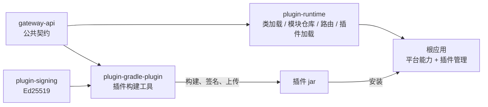
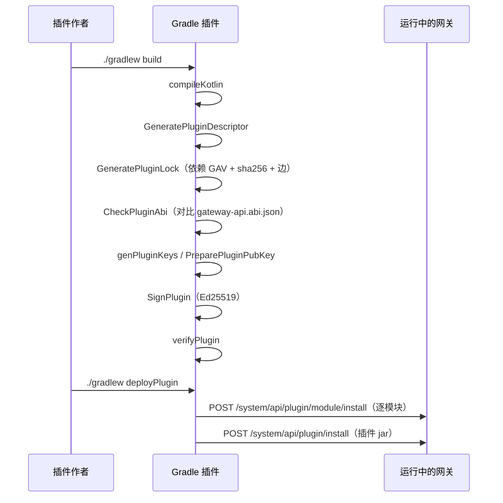
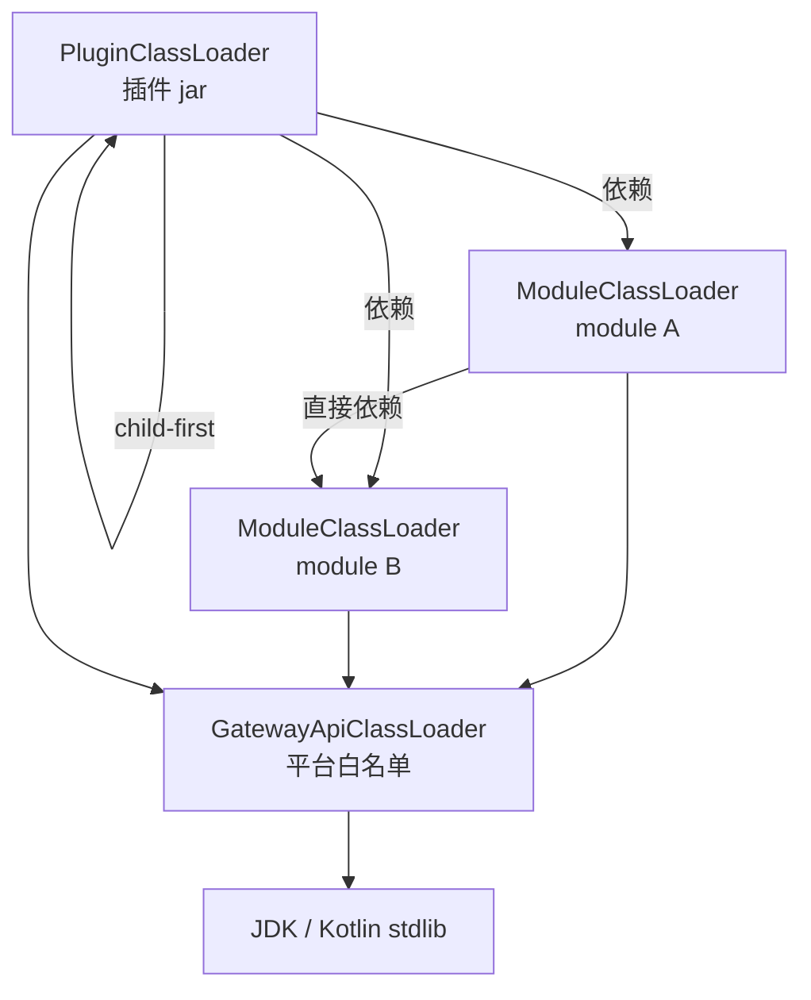
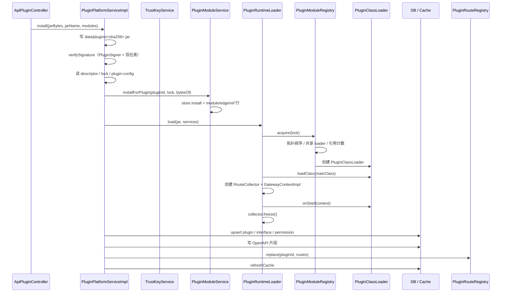
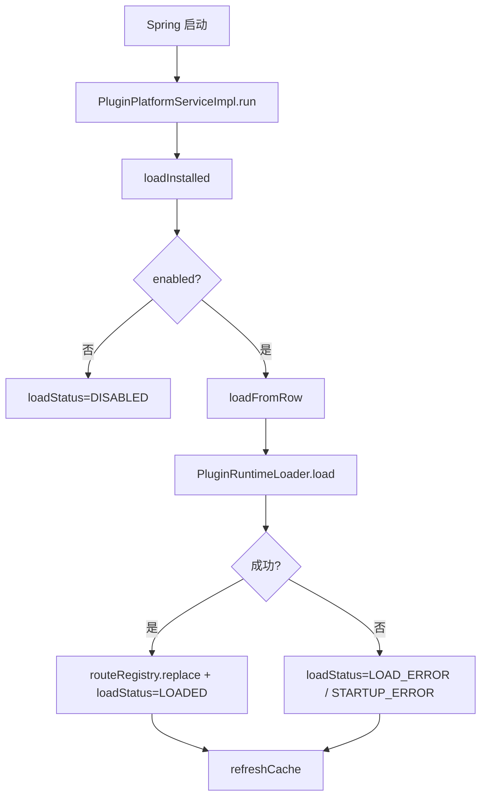
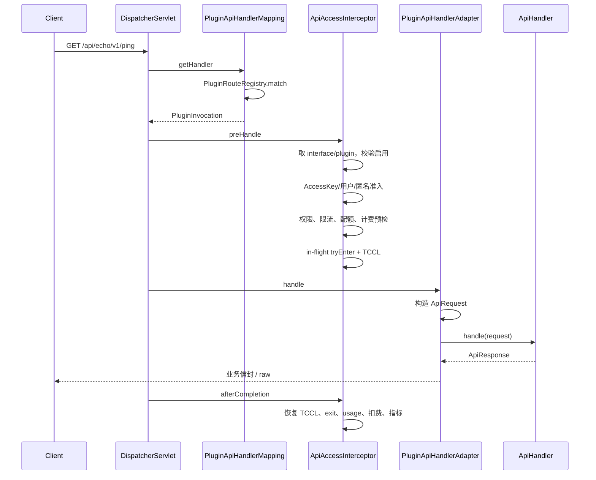
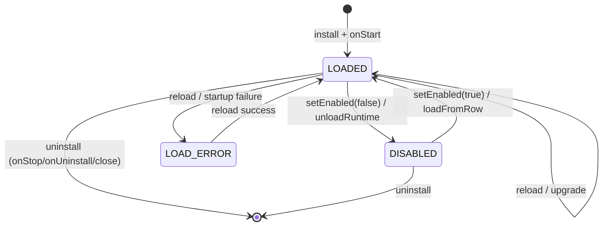
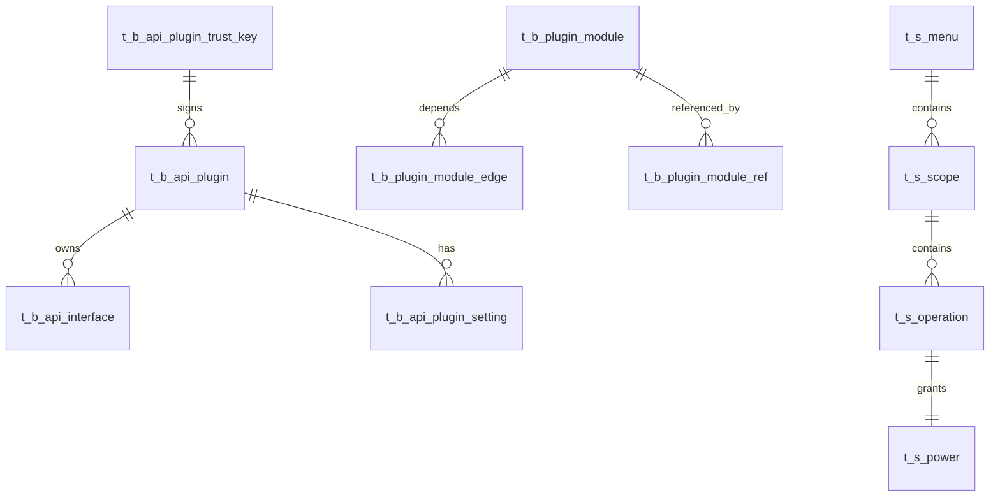

# 插件平台整体逻辑

[English](plugin-platform.md) | 简体中文

本文按“构建 → 安装 → 启动 → 请求 → 停用/卸载”的顺序说明当前网关的插件体系，包含模块、关键文件、组件关系与调用链。

## 1. 设计目标

- 网关核心只负责平台能力：用户、RBAC、审计、AccessKey、计费、限流、配置、插件管理。
- API 功能全部由插件提供。
- 插件可见的平台面只有 **JDK + Kotlin stdlib + `gateway-api`**；Spring、Jackson、MyBatis、Hikari、JDBC 驱动、Flyway 等都是插件自己的模块。
- 插件依赖在构建期锁定，运行期只按 lock 取用，不解析版本。
- 插件只能通过 `GatewayContext` 使用平台能力；不暴露 Spring 容器。
- 插件 jar 必须 Ed25519 签名，签名者必须在信任密钥表中启用。

## 2. 代码模块地图



| 模块 | 作用 |
|---|---|
| `gateway-api/` | 插件唯一依赖的稳定契约：生命周期、路由、请求/响应、能力接口 |
| `plugin-runtime/` | 网关侧运行时：平台类加载器、模块类加载器、模块仓库、lock、路由表、插件加载器 |
| `plugin-signing/` | 网关与 Gradle 工具共用的 Ed25519 签名/验签 |
| `plugin-gradle-plugin/` | 插件作者工具：descriptor、lock、ABI 校验、签名、部署 |
| 根应用 `src/main/kotlin/...` | 平台核心、管理 API、数据库、鉴权、计费、审计、插件安装编排 |

## 3. 契约层：`gateway-api`

包名：`top.fatweb.apimanagement.api.v1`。

### 3.1 生命周期与路由

| 文件 | 内容 |
|---|---|
| `ApiPlugin.kt` | `onStart(GatewayContext)`、`onStop()`、`onUninstall()`、`onPurge()` |
| `GatewayContext.kt` | 插件唯一入口，聚合所有能力 |
| `ApiRoutes.kt` | `register(RouteDefinition, ApiHandler)`，只在 `onStart` 期间有效 |
| `ApiHandler.kt` | 单请求处理 SAM 接口 |
| `RouteDefinition.kt` | HTTP method、插件相对路径、route API 版本、`OperationMetadata` |
| `OperationMetadata.kt` | `operationId`、summary、description、参数、请求体 schema、响应、tags |
| `ParameterSpec.kt` / `ParameterLocation.kt` | 参数名、位置（path/query/header/cookie）、类型、format、枚举、是否必填、说明、示例 |
| `ResponseSpec.kt` | 响应说明、响应体 schema、示例 |
| `SchemaSpec.kt` | 请求体/响应体的递归 JSON Schema 节点：类型、format、properties、required、items、枚举、示例、可空 |

路由最终暴露为：

```
/api/{pluginId}/v{route.apiVersion}{route.path}
```

请求版本可以高于声明版本；同一路径有多个声明版本时，选“不高于请求版本的最高声明版本”。

### 3.2 请求与响应

| 文件 | 内容 |
|---|---|
| `ApiRequest.kt` | method、path、请求 API 版本、path/query/header、principal、traceId、interfaceInfo、原始 body |
| `ApiResponse.kt` | 业务信封 `{code, success, msg, data}`；`raw()` 可绕过信封返回字节/文本 |
| `ApiException.kt` | 插件业务异常，网关转换为统一错误响应 |
| `ApiPrincipal.kt` / `PrincipalType.kt` | 调用者身份：匿名、登录用户、AccessKey |
| `InterfaceInfo.kt` | 当前接口的运行期治理快照：code、价格、计费模式、限流、访问模式等 |
| `Balance.kt`、`UserInfo.kt`、`PluginMetadata.kt` | 只读平台数据与运行时元数据 |

### 3.3 能力接口

| 文件 | 能力 |
|---|---|
| `Settings.kt` | 插件配置读取、secret 读取、插件自有 key 写入 |
| `DataSources.kt` | 插件私有数据源，返回 `javax.sql.DataSource` |
| `Storage.kt` | 内容寻址（SHA-256）+ 位置寻址文件 + 免登外链 |
| `Users.kt` | 只读用户信息、余额 |
| `AuditSink.kt` / `AuditEvent.kt` | 写平台审计 |
| `EventBus.kt` / `Subscription.kt` | 进程内事件总线，卸载时可统一取消 |
| `HttpCapability.kt` | 出站 HTTP |
| `Scheduler.kt` | 固定延迟 / cron 调度，卸载时统一取消 |
| `JsonCodec.kt` | 网关 JSON 编解码，避免插件接触 Jackson 类型 |
| `PluginLogger.kt` | 带 pluginId / traceId 的日志 |

### 3.4 ABI 清单

`gateway-api/build.gradle.kts` 的 `GenerateGatewayApiAbi` 在构建时扫描编译产物，生成：

```
META-INF/gateway-api.abi.json
```

包含 public/protected 类、构造器、方法、字段的 JVM descriptor。插件构建时用它与插件字节码比对。

### 3.5 Java 插件作者

- 回调接口都是 SAM：`ApiHandler`、`EventBus.EventSubscriber`、`Subscription`。
- 工厂方法带 `@JvmStatic`，带默认参数构造器带 `@JvmOverloads`。
- `GatewayContext` 使用访问函数 `ctx.api()`、`ctx.settings()`，不是 Kotlin 属性。

## 4. 构建期：`plugin-gradle-plugin`



| 文件 | 作用 |
|---|---|
| `ApiPluginExtension.kt` | `apiPlugin { }` DSL：pluginId、versionCode、mainClass、requiresGateway、requiresGatewayApi、部署参数 |
| `ApiPlugin.kt` | 应用插件、加 `compileOnly gateway-api`、注册所有 task、把生成目录放进 jar |
| `ApiPluginTasks.kt` | `GeneratePluginDescriptor`、`GenPluginKeys`、`PreparePluginPubKey`、`SignPlugin`、`VerifyPlugin`、`DeployPlugin` |
| `GeneratePluginLock.kt` | 从 `runtimeClasspath` 生成 `META-INF/api-plugin-deps.json`，并把模块 jar 复制到 `build/generated/api-plugin-modules/` |
| `CheckPluginAbi.kt` | 解析插件 class 常量池，检查对 `top.fatweb.apimanagement.api.*` 的类/方法/字段/构造器引用 |
| `plugin-signing/PluginSigner.kt` | 构建 jar 清单、签名、验签、SPKI 指纹 |

### 插件 jar 关键条目

```
META-INF/api-plugin.json        描述符 format 1
META-INF/api-plugin-deps.json   依赖 lock
META-INF/plugin.pub.pem         签名公钥
META-INF/plugin.sig             Ed25519 签名
```

`GeneratePluginLock` 默认排除：

- `top.fatweb:api-management-gateway-api`（平台提供）
- `org.jetbrains.kotlin:kotlin-stdlib*`（平台提供）
- `org.jetbrains:annotations`

其余运行期依赖全部进入 lock，并以独立模块形式上传。

## 5. 运行时：类加载与模块仓库

### 5.1 三层类加载器



| 文件 | 作用 |
|---|---|
| `classloader/GatewayApiClassLoader.kt` | 只放行 `java.`、`javax.`、`jdk.`、`sun.`、`kotlin.`、`top.fatweb.apimanagement.api.`；其余 `ClassNotFoundException` |
| `classloader/ModuleClassLoader.kt` | child-first：自己 jar → 直接依赖模块 loader → 平台 |
| `classloader/PluginClassLoader.kt` | child-first：插件 jar → lock 中的模块 loader → 平台 |
| `classloader/ModuleKey.kt` | 共享键：GAV + sha256 + 直接依赖指纹 |
| `classloader/PluginModuleRegistry.kt` | 全局共享、引用计数、拓扑加载、`PluginModuleGraph` |

### 5.2 模块仓库

| 文件 | 作用 |
|---|---|
| `module/PluginModuleLock.kt` | lock 模型与校验：重复坐标、非法 digest、缺依赖、循环、SNAPSHOT |
| `module/PluginModuleLockParser.kt` | 解析 `META-INF/api-plugin-deps.json` |
| `module/PluginModuleStore.kt` | 模块存储接口 |
| `module/FileSystemPluginModuleStore.kt` | `data/plugin-modules/<sha256>.jar`；SHA 校验、原子写入、大小/数量限制、GC |

模块共享规则：

- 同一 `(GAV, sha256, 直接依赖指纹)` 共享一个 `ModuleClassLoader`。
- 不同版本 GAV 不同，自然并存。
- 插件卸载时释放引用；引用归零关闭 loader。
- 磁盘模块按插件引用集合 GC，未引用超过宽限期才删除。

## 6. 网关侧 Spring 装配

| Bean / 组件 | 文件 | 作用 |
|---|---|---|
| `GatewayApiClassLoader`、`PluginRouteRegistry`、`PluginModuleRegistry`、`PluginRuntimeLoader` | `config/PluginRuntimeConfig.kt` | 运行时基础 Bean |
| `PluginApiHandlerMapping`、`PluginApiHandlerAdapter` | `config/PluginWebConfig.kt` | 把插件路由接入 Spring MVC |
| `PluginPlatformServiceImpl` | `service/api/impl/PluginPlatformServiceImpl.kt` | 安装/升级/启停/卸载/reload、配置、接口治理 |
| `PluginModuleServiceImpl` | `service/api/impl/PluginModuleServiceImpl.kt` | 模块安装、引用、释放、分页、GC |
| `PluginModuleEdgeServiceImpl`、`PluginModuleRefServiceImpl` | `service/api/impl/` | 模块边/引用，MyBatis-Plus service |
| `ApiInterfaceServiceImpl` | `service/api/impl/ApiInterfaceServiceImpl.kt` | 接口行持久化 |
| `PluginCapabilityFactory` | `component/plugin/runtime/PluginCapabilityFactory.kt` | 为每个插件装配 `GatewayContext` 能力 |
| `PluginEventBus` | `component/plugin/runtime/PluginEventBus.kt` | 进程内事件，按 pluginId 归属 |
| `PluginScheduler` | `component/plugin/runtime/PluginScheduler.kt` | 固定延迟/cron，按 pluginId 取消 |
| `PluginHttpClient` | `component/plugin/runtime/PluginHttpClient.kt` | JDK HttpClient |
| `PluginOpenApiBuilder` | `component/plugin/runtime/PluginOpenApiBuilder.kt` | 从路由元数据生成 OpenAPI 3.1 片段 |
| `PluginRegistryCache` | `component/plugin/PluginRegistryCache.kt` | 请求热路径的 plugin / interface 快照 |
| `PluginConfigSchemaCache` | `component/plugin/PluginConfigSchemaCache.kt` | 已安装插件的配置 schema 缓存 |
| `PluginInFlightTracker` | `component/plugin/PluginInFlightTracker.kt` | 在途请求计数与排空 |

管理入口：

| Controller | 作用 |
|---|---|
| `controller/system/ApiPluginController.kt` | 插件列表、详情、安装、升级、启停、卸载、reload、配置、接口治理 |
| `controller/system/PluginModuleController.kt` | 模块分页、上传、删除、GC |
| `controller/system/ApiTrustKeyController.kt` | 信任公钥管理 |

## 7. 安装 / 升级流程



### 7.1 具体步骤

1. `PluginPlatformServiceImpl.install`
   - 校验 jar 大小。
   - 计算 SHA-256，写 `data/plugins/<sha>.jar`。
   - `verifySignature`：
     - `PluginSigner.readPublicKey`
     - `PluginSigner.verify`
     - `PluginSigner.spkiFingerprint`
     - `IApiPluginTrustKeyService.getByKeyId`，必须 `enable == 1`
   - `readDescriptor`：`PluginDescriptorParser` 校验 format 1、pluginId、版本、mainClass、版本范围。
   - 读取 lock：`PluginModuleLockParser`。
   - 读取 `META-INF/plugin-config.json`，`PluginConfigSchemaUtil.parse`，写入 `PluginConfigSchemaCache`。
2. 升级时先卸载当前运行时：
   - `unloadRuntime(..., uninstalling = true)`：排空、注销路由、取消事件/调度、`onStop`、`onUninstall`、关闭 loader。
   - `moduleService.release(pluginId)`：释放当前模块引用。
3. 模块安装：
   - 上传的模块通过 `PluginModuleController.install` -> `IPluginModuleService.stage` 先进入模块仓库。
   - `installForPlugin` 对 lock 中每个模块：
     - `FileSystemPluginModuleStore.install` 校验 SHA 并落盘。
     - `PluginModule` 行 upsert。
     - `t_b_plugin_module_edge` 写直接依赖边。
     - `t_b_plugin_module_ref` 写插件引用。
4. 运行时装配：
   - `PluginRuntimeLoader.load`
     - `PluginDescriptorParser.parse`
     - `checkRequirements`：`Semver` + `VersionRange` 校验 `requiresGateway` / `requiresGatewayApi`
     - `PluginModuleRegistry.acquire(lock)`：构建模块 loader 图
     - `PluginClassLoader`
     - `RouteCollector` + `GatewayContextImpl`
     - 反射实例化 `mainClass`
     - 在插件 TCCL 下执行 `onStart`
     - `RouteCollector.freeze()` 校验 operationId/路径冲突
5. 持久化：
   - `upsertPluginRow`：插件行、descriptor 字段、lock、load status、OpenAPI。
   - `registerEndpoints`：
     - 确保菜单/scope/operation/power
     - 按 `operationId` 生成接口 code
     - 更新/插入 `t_b_api_interface`
     - 路径变更时先用 `#moving:<id>` 占位避免唯一键冲突
     - 删除新版本未提供的接口
   - `routeRegistry.replace(pluginId, loaded.routes)`
   - `refreshCache`：刷新 `PluginRegistryCache` 与 `PluginConfigSchemaCache`
6. 失败清理：
   - 关闭已创建的 loader/run
   - 释放模块引用
   - 删除新 jar
   - 抛出 `PluginInstallException`

### 7.2 版本升级语义

- `versionCode` 更小拒绝安装。
- 同版本允许覆盖安装，便于开发循环。
- 升级保留管理员配置：插件级/接口级价格、限流、访问模式、启用状态、权限授权都按 code 保留。
- 升级时，被替换的版本执行 `onUninstall`；不执行 `onPurge`。
- 被替换的 jar 文件在新安装成功后删除。

## 8. 启动恢复



相关文件：

- `PluginPlatformServiceImpl.kt`：`run` / `loadInstalled` / `loadFromRow` / `refreshCache`
- `PluginRuntimeLoader.kt`：实际加载与 `onStart`
- `PluginRouteRegistry.kt`：恢复路由
- `PluginRegistryCache.kt`：请求热路径缓存

启动失败不会阻塞网关；插件行保留，管理端展示 `loadError` / `loadErrorCode`。

## 9. 请求执行链路



### 9.1 路由匹配

`plugin-runtime/route/PluginRouteRegistry.kt`：

- 正则：`^/api/([^/]+)/v(\d+)(/.*)?$`
- 根据 method + pluginId 过滤。
- `PathPattern.matchAndExtract` 提取 path 变量。
- 请求版本 >= 声明版本。
- 版本优先，其次路径具体度（`PathPattern.SPECIFICITY_COMPARATOR`）。

`plugin-runtime/route/PluginApiHandlerMapping.kt`：

- 继承 `AbstractHandlerMapping`。
- `order = Ordered.HIGHEST_PRECEDENCE + 10`。
- 返回 `PluginInvocation`（pluginId、apiCode、version、handler、classLoader）。
- 拦截器由 `PluginWebConfig` 传入：`SysLogInterceptor`、`ApiAccessInterceptor`。

### 9.2 准入与治理

`aspectj/ApiAccessInterceptor.kt`：

- 非 `PluginInvocation`：如果是已安装但停用的插件 URL，抛 `ApiDisabledException`。
- `PluginInvocation`：
  - 从 `PluginRegistryCache` 取 `ApiInterface` 和 `ApiPlugin`。
  - 校验启用状态。
  - `ApiKeyPrincipal`：权限 code、key 限流、配额、计费预检、余额扣减。
  - `LoginUser`：RESTRICTED 模式权限、接口限流、余额预检；超管免费。
  - 匿名：`needKey == 1` 时拒绝。
  - `PluginInFlightTracker.tryEnter`。
  - 设置 TCCL 为插件 loader。
- `afterCompletion`：
  - 恢复 TCCL
  - 退出 in-flight
  - 记 usage
  - 按计费模式扣费/流水
  - 写 Redis 指标

### 9.3 请求/响应适配

`plugin-runtime/route/PluginApiHandlerAdapter.kt`：

- 构造 `ApiRequest`：path/query/header、principal、traceId、interfaceInfo、raw body。
- 设置 TCCL。
- 调用 `ApiHandler.handle`。
- `ApiException` -> `ApiResponse.fail`。
- 其他异常/`LinkageError` -> 500。
- 普通响应序列化为 `{code, success, msg, data}`；`raw` 直接写字节。
- 恢复 TCCL。

## 10. 生命周期状态



### 10.1 停用

`PluginPlatformServiceImpl.setEnabled(false)`：

- `unloadRuntime(..., purge=false, uninstalling=false)`
  - `inFlightTracker.beginDrain`
  - `routeRegistry.unregisterPlugin`
  - `eventBus.removePlugin`
  - `scheduler.removePlugin`
  - `inFlightTracker.awaitDrain(10s)`
  - `LoadedPlugin.stop`
  - 不执行 `onUninstall`
  - 关闭 plugin loader 与 module graph
- 模块引用保留，重新启用不需要重新上传。

### 10.2 启用

`setEnabled(true)`：

- 没有 runtime 时 `loadFromRow(row)`。
- 重新 `runtimeLoader.load`、`routeRegistry.replace`。
- 更新 `loadStatus=LOADED`。

### 10.3 reload

`reload(pluginId)`：

- 卸载当前 runtime（不执行 uninstall）。
- 从已存 jar 重新加载。
- 重新生成 OpenAPI。
- 失败写 `LOAD_ERROR`。

### 10.4 卸载

`uninstall(pluginId, purgeData)`：

1. `unloadRuntime(purge=..., uninstalling=true)`：
   - 排空 → 注销路由 → 取消事件/调度 → `onPurge`（可选）→ `onStop` → `onUninstall` → 关 loader
2. 释放模块引用
3. 删除接口行、权限树、插件行
4. 清理 schema 缓存
5. `purgeData=true` 时删除 settings、SQLite 数据目录、插件文件区
6. 删除 jar 文件
7. `refreshCache`

## 11. `GatewayContext` 能力实现

`component/plugin/runtime/PluginCapabilityFactory.kt` 为每个插件构造 `PluginRuntimeServices`，再由 `GatewayContextImpl` 暴露。

| 能力 | 实现 |
|---|---|
| `api()` | `RouteCollector`（启动期间）→ `RegisteredRoute` |
| `settings()` | `PluginSettingReader` + `IApiPluginSettingService` + `PluginConfigSchemaCache` |
| `dataSources()` | `PluginDatasourceFactory`（按 schema 创建 Hikari 池 / SQLite 文件） |
| `storage()` | `PluginStorageFactory` → `PluginStorageImpl`（实现 `gateway-api` 的 `Storage`） |
| `users()` | `UserMapper` + `UserInfoMapper` + `IApiAccountService` |
| `audit()` | `EventLogMapper` |
| `events()` | `PluginEventBus.scoped(pluginId)` |
| `http()` | `PluginHttpClient.capability()` |
| `scheduler()` | `PluginScheduler.scoped(pluginId)` |
| `json()` | 网关 `JsonMapper` |
| `logger()` | SLF4J，logger 名 `plugin.<pluginId>` |
| `metadata()` | descriptor + 网关/API 版本 |

## 12. 数据模型



| 表 | 作用 |
|---|---|
| `t_b_api_plugin` | 插件行：版本、jar hash、签名者、descriptor 字段、lock、load status/error、OpenAPI |
| `t_b_api_interface` | 路由/接口行：code、path、method、apiVersion、计费/限流/访问模式 |
| `t_b_api_plugin_setting` | 插件配置值（secret 存密文） |
| `t_b_api_plugin_trust_key` | 可信签名公钥 |
| `t_b_plugin_module` | 依赖模块：`module_version` 是 Maven 版本，`version` 是乐观锁 |
| `t_b_plugin_module_edge` | 模块直接依赖边，带 `version` 乐观锁 |
| `t_b_plugin_module_ref` | 插件对模块的引用，带 `version` 乐观锁 |
| `t_s_menu` / `t_s_scope` / `t_s_operation` / `t_s_power` | 插件接口的权限树 |

对应实体：

- `entity/api/ApiPlugin.kt`
- `entity/api/ApiInterface.kt`
- `entity/api/PluginModule.kt`
- `entity/api/PluginModuleEdge.kt`
- `entity/api/PluginModuleRef.kt`
- `entity/permission/Menu.kt`、`Scope.kt`、`Operation.kt`、`Power.kt`

`PluginPlatformServiceImpl` 与 `PluginModuleServiceImpl` 均按 MyBatis-Plus 规范：

- 接口继承 `IService<Entity>`
- 实现继承 `ServiceImpl<Mapper, Entity>`
- 主实体使用 `save` / `updateById` / `getOne` / `list` / `page` / `removeById`

## 13. 配置、数据源、存储、OpenAPI

### 13.1 配置

- 插件 jar 内 `META-INF/plugin-config.json`。
- 安装时 `PluginConfigSchemaUtil.parse`，写入 `PluginConfigSchemaCache`。
- `GatewayContext.settings().get/save` 由 `PluginSettingReader` / `IApiPluginSettingService` 支撑。
- 管理员配置的 key 插件不能写；secret 由网关解密。
- 数据源相关配置变化后 `updatePluginConfig` 在事务提交后调用 `reload(pluginId)`。

### 13.2 数据源

`component/plugin/PluginDatasourceFactory.kt`：

- 根据 schema 的 `datasources` 声明创建。
- SQLite：网关提供 `data/db/plugin/{pluginId}/{name}.db`。
- MySQL：由配置项拼 JDBC URL，Hikari 池。
- 插件只能通过 `context.dataSources()` 拿到自己的连接池。

### 13.3 存储

`component/plugin/PluginStorageImpl.kt`：

- 实现 `gateway-api` 的 `Storage`。
- 内容寻址：`IStorageBlobService`，SHA-256 去重 + 引用计数。
- 位置寻址：`FileStorageProvider`，限定 `plugin-data/{pluginId}/...`。
- 外链：本地 HMAC 签名 URL 或 S3 presigned URL。

### 13.4 OpenAPI

`component/plugin/runtime/PluginOpenApiBuilder.kt`：

- 从 `RegisteredRoute` + `OperationMetadata` 生成 OpenAPI 3.1 JSON。
- 参数带 `type`、`format`、`enum`、`required`、`description`、`example`。
- 响应带 `description`、`content.application/json` schema、`example`；未声明响应时回落为 `200 OK`。
- 请求体与响应体 schema 用 `SchemaSpec` 声明并渲染为 JSON Schema，插件不需要手写 schema JSON。
- 写入 `t_b_api_plugin.openapi`。
- `ApiDocServiceImpl` 读取该字段提供用户 API 文档页。

## 14. 版本、ABI、签名、安全

### 版本

- `requiresGateway`：网关应用版本范围。
- `requiresGatewayApi`：gateway-api 契约版本范围；它的最小版本同时作为插件的 gateway-api 编译依赖。
- `apiVersion`：由 `requiresGatewayApi` 的最小版本大版本推导。
- 网关侧的 gateway-api 版本与大版本从 gateway-api jar 的 `META-INF/gateway-api.properties` 读取。
- `RouteDefinition.apiVersion`：插件自己的 HTTP API 版本（URL 中的 `v{n}`），和上面的契约版本无关。
- `Semver` / `VersionRange` 在 `PluginRuntimeLoader.checkRequirements` 校验；本地 `1.0.0-SNAPSHOT` 会去掉 qualifier 再比较。

### ABI

- `gateway-api` 构建生成 `META-INF/gateway-api.abi.json`。
- 插件 `CheckPluginAbi` 在构建期扫描字节码引用，缺类/方法/字段/构造器直接构建失败。
- 运行期当前校验 API 大版本与版本范围；没有做完整的运行期 ABI 符号复检。

### 签名

- `PluginSigner`：对 jar 所有非签名条目做 SHA-256 清单，附加公钥 PEM，再 Ed25519 签名。
- 网关安装时验签 + 信任表校验。
- 模块不在插件签名内，但 lock 记录每个模块的 SHA-256，模块仓库写入/读取时校验。

### 安全边界

- 不是沙箱；同 JVM 内签名可信插件仍可用反射。
- 依赖模块只能通过管理员上传或部署工具上传，插件运行期不能触发安装。
- 网关只向插件暴露 JDK、Kotlin stdlib、`gateway-api`。

## 15. 关键调用索引

| 入口 | 主要调用链 |
|---|---|
| 安装插件 | `ApiPluginController.install` → `PluginPlatformServiceImpl.install` → `PluginModuleServiceImpl.installForPlugin` → `PluginRuntimeLoader.load` → `PluginModuleRegistry.acquire` → `PluginClassLoader.onStart` → `registerEndpoints` → `PluginRouteRegistry.replace` |
| 模块上传 | `PluginModuleController.install` → `PluginModuleServiceImpl.stage` → `FileSystemPluginModuleStore.install` |
| 启动恢复 | `PluginPlatformServiceImpl.run` → `loadInstalled` → `loadFromRow` → `PluginRuntimeLoader.load` |
| 请求 | `PluginApiHandlerMapping.getHandlerInternal` → `ApiAccessInterceptor.preHandle` → `PluginApiHandlerAdapter.handle` → `ApiHandler.handle` |
| 停用 | `ApiPluginController.updatePluginStatus` → `PluginPlatformServiceImpl.setEnabled(false)` → `unloadRuntime` |
| 卸载 | `ApiPluginController.uninstall` → `PluginPlatformServiceImpl.uninstall` → `unloadRuntime` → `remove` 行 → `refreshCache` |
| 配置保存 | `ApiPluginController.updateConfig` → `PluginPlatformServiceImpl.updatePluginConfig` → `onCommitted { reload }` |
| 文档 | `UserApiDocController` → `ApiDocServiceImpl` → `PluginOpenApiBuilder` 生成的 `openapi` 字段 |

## 16. 当前边界

- 模块目前由 `deployPlugin` 或管理端上传，未实现在线 Maven 仓库解析。
- 运行期 ABI 只校验 API 大版本/版本范围，完整符号检查在构建期。
- 示例插件在独立仓库维护。

